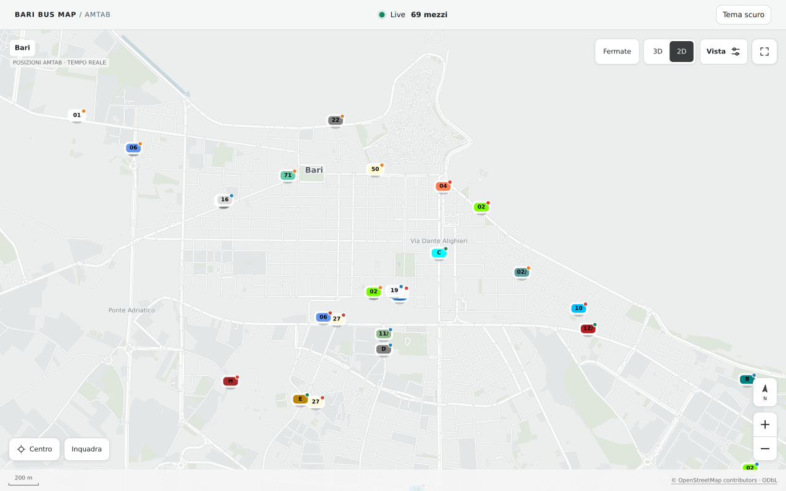
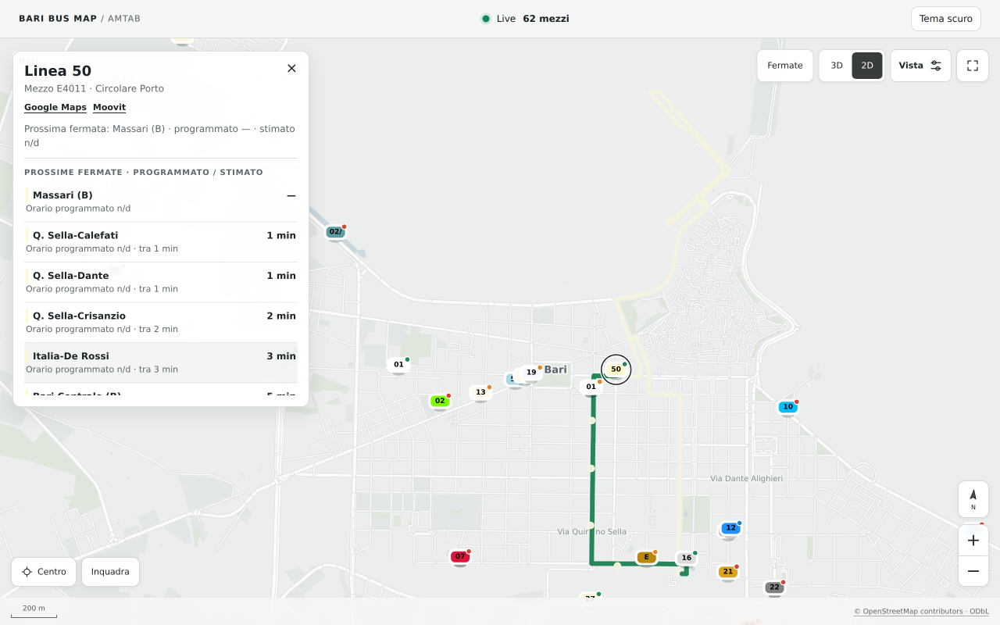
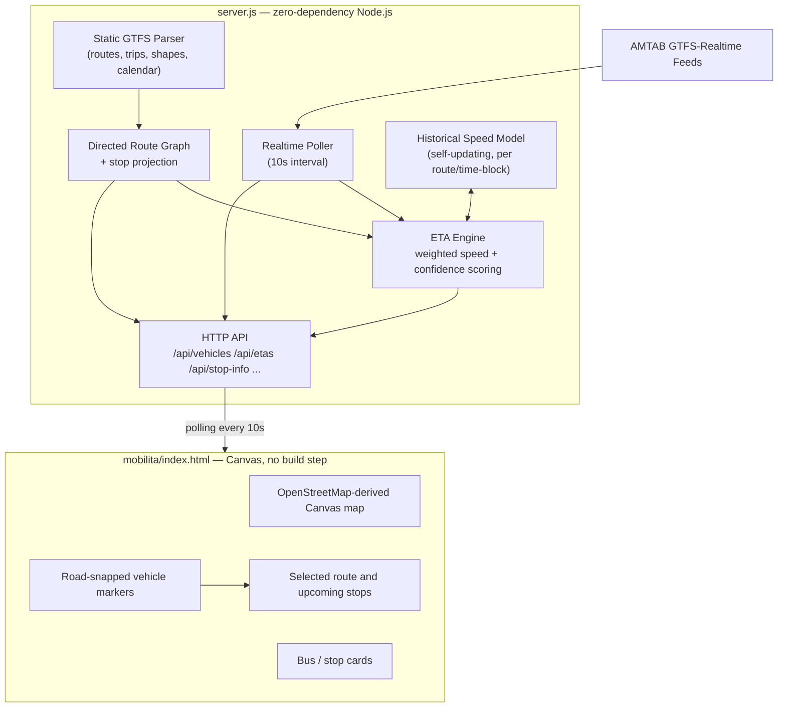

<div align="center">

# Bari AMTAB — Real-time Bus Map

**A live, geometrically-aware map of Bari's city buses — built from scratch, zero runtime dependencies.**

[](https://github.com/pancake37/bari-bus-map/actions/workflows/eslint.yml)


<p align="center">
  
  
</p>

</div>

---

## What is this?

The home page shows **AMTAB buses moving live around Bari** on a lightweight Canvas map. Select a bus to see its route and stop-by-stop schedule and estimates; the next stops appear first, while past stops stay tucked away until opened. The map also lets you toggle stops and change the view.

Behind the map, the server builds a **directed graph of every route shape**, projects each GPS ping onto it, and predicts arrivals using live speed and self-learned historical averages.

No React. No build step. No database. Just `node server.js` and a browser tab.

## Features

| | |
|---|---|
| **Live bus map** | Shows current AMTAB vehicle positions over an OpenStreetMap-derived base map. Selecting a bus draws its route and opens its upcoming stops and arrival estimates. |
| **Upcoming-first stop list** | Already-passed stops are collapsed by default; open the disclosure to review them. |
| **Map controls** | Toggle stops, switch between 2D and 3D, adjust the view, or return to the city center. The default camera is 2D, centered, at −5° rotation with full relief and base zoom. |
| **Geometric ETA engine** | Projects each vehicle onto a directed graph of the route shape (not a straight line to the next stop) and predicts downstream arrivals segment-by-segment, blending instantaneous GPS speed with a self-learned historical average per route and time-of-day block. |
| **Confidence-scored predictions** | Cross-checks the geometric projection against the GTFS-RT `CurrentStopSequence` field. If they disagree by more than one stop, the ETA is flagged `low` confidence in the API and shown as an estimate in the UI instead of a live pulse. |
| **Schedule vs realtime status** | The bus card compares programmed and estimated arrival per stop, and shows late / early / unknown from GTFS-RT delays. |
| **Scheduled fallback** | Stop panels list today's upcoming programmed passes (like MyCicero's "Orario dei passaggi") with a live overlay when the trip is monitored; any programmed pass opens its full trip detail ("Dettaglio corsa"). |
| **Realtime delay history** | Trip delays are retained 15 min after a trip drops out of the feed (flagged `stale`), so badges don't flicker to unknown between polls — same as MyCicero keeping realtime per solution. |
| **Accessible panels** | Stop cards, bus timeline rows and trip rows carry full-sentence aria-labels (line, destination, ETA, delay status) and are keyboard-operable (Enter/Space). |
| **Calendar-aware schedules** | Parses `calendar.txt` / `calendar_dates.txt` so the stop timeline only shows trips that actually run *today* — no more Sunday-only routes appearing on a Tuesday. |
| **Road-snapped animation** | Buses animate along the actual route geometry between GPS updates (via waypoint interpolation), instead of cutting straight through city blocks. |
| **Self-learning speed model** | Historical average speed per route/time-block updates online from every observed GPS ping — no offline training step, no static lookup table. |
| **Graceful degradation** | If the AMTAB real-time feed hiccups, the server serves a 5-minute-TTL backup instead of an empty map. |
| **Light/dark theme** | Toggles the UI and Canvas map styling; choice persists across sessions via `localStorage`. |
| **Minimalist map design** | A bundled OpenStreetMap-derived map keeps streets, stops and vehicles easy to distinguish. |
| **On-demand route shapes** | Route shapes are fetched as needed for active buses and cached by the browser. |
| **One-tap deep links** | Stop and vehicle panels link straight out to Google Maps / Moovit by coordinates. |

## Architecture



## How the ETA model works

For the current segment (bus → next stop), speed is a weighted blend of live GPS speed and the historical average for that route/hour, weighted by how far along the segment the bus already is:

$$
v_i = \frac{S_{ib} \cdot v_r + S_{if} \cdot v_{ai}}{S_{ib} + S_{if}}
$$

Where $S_{ib}$ is distance already covered on the segment, $S_{if}$ is distance remaining, $v_r$ is the bus's current reported speed, and $v_{ai}$ is the learned historical average for that route and time-of-day block. Rush-hour (06:00–10:00, 15:00–19:00) applies a 0.85× dampening factor; downstream stops beyond the immediate segment fall back to the historical average alone.

The historical average itself is never hand-tuned — every valid GPS observation (`speed > 10 km/h`) folds into the running average for its route and 2-hour time block, so the model adapts as AMTAB's actual traffic patterns change across seasons.

## API Reference

| Endpoint | Cache | Description |
|----------|-------|-------------|
| `GET /api/vehicles` | no-store | Live vehicle positions from the GTFS-RT feed |
| `GET /api/trip-updates` | no-store | Per-trip delay in seconds (`{ [tripId]: delay }`; trips without RT data are omitted = unknown) |
| `GET /api/trip-detail?tripId=` | no-store | Per-trip realtime detail `{ tripId, delay, stops: { [stopId]: { delay, time, sequence } }, shapeId }` (`delay: null` = unknown) |
| `GET /api/trip-timetable?tripId=` | static | Static schedule `[{ stop_id, arrival, sequence }]` for schedule-vs-realtime comparison |
| `GET /api/stop-timetable?stopId=` | no-store | Upcoming scheduled passes for today `[{ trip_id, route_id, arrival, headsign, direction, delay, stale, monitored }]` (active services only, MyCicero-style fallback; `delay` falls back to last-known realtime ≤15 min, `stale: true` then) |
| `GET /api/etas` | no-store | `{ [stopId]: { [routeId]: { eta, delay, vid, confidence } } }` |
| `GET /api/otp` | no-store | Per-route OTP `{ total, onTime, otpPct }` (trips with unknown delay excluded) |
| `GET /api/stats` | no-store | Vehicle count, buffer sizes, historical routes |
| `GET /api/status` | no-store | RT-feed freshness and cached-data flags |
| `GET /api/routes` | static | Route catalog |
| `GET /api/stops` | static | All stop coordinates |
| `GET /api/stop-info` | static | Today's active departures per stop (calendar-filtered) |
| `GET /api/route-shapes` | static | Active shapes per route (service calendar) |
| `GET /api/shape-stops` | static | Ordered stops per shape |
| `GET /api/shapes?id=&encoded=1` | static | Shape geometry (JSON or encoded polyline) |

### ETA confidence

- **`high`** — geometric next stop's trip `stop_sequence` agrees with RT `CurrentStopSequence` within 1.
- **`low`** — disagreement > 1 (treat ETA as approximate).
- **`unknown`** — no RT sequence or no trip map for that trip.

## Quick Start

```bash
git clone https://github.com/pancake37/bari-bus-map.git
cd bari-bus-map
# place AMTAB's static GTFS archive as google_transit.zip in the repo root
node server.js
# open http://localhost:3000
```

No `npm install` required for the server — it runs on Node's built-in `http`/`fs`/`child_process` modules only.

```bash
npm test    # unit tests (CSV, calendar rebuild, ZIP extract)
```

## Data Sources

| Feed | URL | Type |
|------|-----|------|
| Vehicle Positions | `https://avl.amtab.it/WSExportGTFS_RT/api/gtfs/VechiclePosition` | GTFS-RT |
| Trip Updates | `https://avl.amtab.it/WSExportGTFS_RT/api/gtfs/TripUpdates` | GTFS-RT |
| Static GTFS | Local `google_transit.zip` | Static GTFS zip |

Note: `VechiclePosition` is the spelling used by the AMTAB endpoint. Its TripUpdates payload also deviates from the usual naming: per-stop updates arrive as `StopTimeUpdates` (plural) with an authoritative top-level `Delay` — the server accepts both shapes.

## Security

Static HTTP only serves:

- `/` → the Canvas live map in `mobilita/index.html`
- `/realtime/` → the previous Leaflet interface
- `/assets/**` and `/mobilita/**` with safe static file extensions

**Not** exposed: `server.js`, `.gtfs-cache.json`, `google_transit.zip`, `data/*` observation logs, `.git/`, etc.

Realtime HTTPS fetches to AMTAB use a **10s timeout** and a 5-minute last-good backup.

The server prevents overlapping polls. When it has to use a backup, `/api/status` and the map header report cached data instead of presenting it as live.

GTFS service selection supports both the usual `calendar.txt` rules and feeds that define service exclusively through `calendar_dates.txt`; stop departures and active shapes are rebuilt together at the local calendar-day boundary.

The included ZIP reader is cross-platform and uses pure JavaScript for stored and deflated archives, with command-line fallbacks only when necessary.

## ⚠️ Known Limitations

- **PowerShell fallback still present** — GTFS ZIP extraction is pure-JS first (works on any OS), with an `unzip` CLI fallback, and `PowerShell Expand-Archive` only as a last resort on Windows if both prior methods fail on an unusual archive. It's dead code on Linux/macOS and should trigger a proper error report if it's ever hit.
- **In-memory state only** — vehicle/ETA caches live in process memory; running multiple server instances behind a load balancer will give each instance a different view of historical speeds.
- **No authentication or rate limiting** on the API — fine for local/single-user use, not yet hardened for public multi-tenant deployment.
- **The home page base map** is bundled from OpenStreetMap-derived data. The legacy `/realtime/` page still loads Esri Canvas tiles from the network.
- **OTP dashboard** is available as JSON API only (no dedicated UI).

## Roadmap

- [ ] Automatic re-download of `google_transit.zip` from AMTAB (the current 24h refresh only re-parses the local copy already on disk — it doesn't fetch a new one over the network)
- [ ] Search bar for finding a stop or line by name/number, instead of only clicking on the map
- [ ] Favorite/starred stops, saved across sessions

## Project layout

```
server.js           HTTP + GTFS + ETA + OTP
mobilita/index.html Canvas live map, bus cards, stop list and map controls
mobilita/cities/    Bundled Bari map data
index.html          Previous Leaflet interface, available at /realtime/
lib/csv.js          CSV line parser
lib/zip.js          ZIP extract (JS-first, with CLI/PowerShell fallbacks)
lib/calendar.js     Service-calendar logic (timezone-aware, calendar_dates-only feeds)
assets/vendor/      Leaflet + MovingMarker (previous interface) + marker icons
assets/demo*.png    README screenshots
assets/favicon.svg  Favicon
data/               hist speeds + observation logs (gitignored)
test/               node:test suite (calendar, csv, zip)
google_transit.zip  static GTFS (required at runtime)
```

## License

[MIT](LICENSE)

## 🙏 Data Source

Built on official [AMTAB](https://www.amtab.it/) (Azienda Mobilità e Trasporti Bari) GTFS and GTFS-Realtime feeds. Not affiliated with or endorsed by AMTAB.
